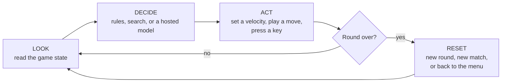
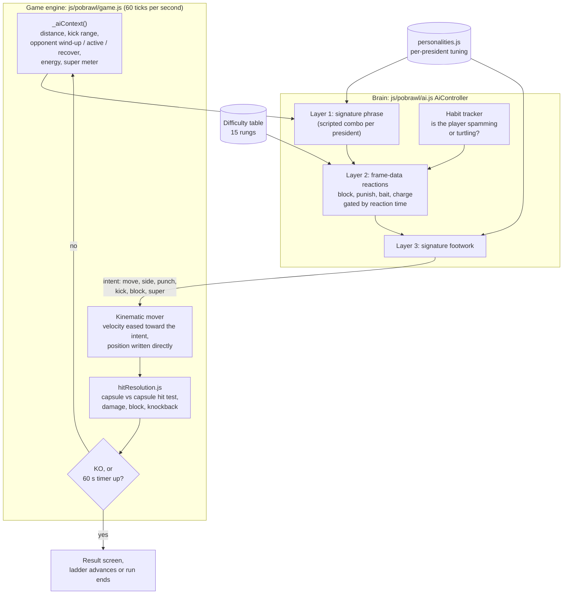
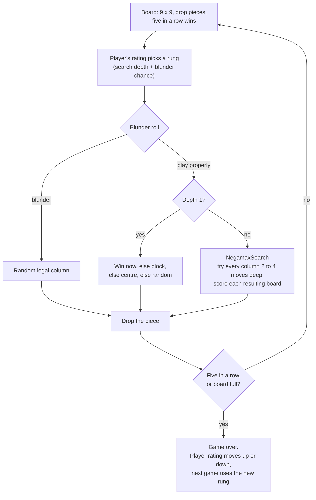
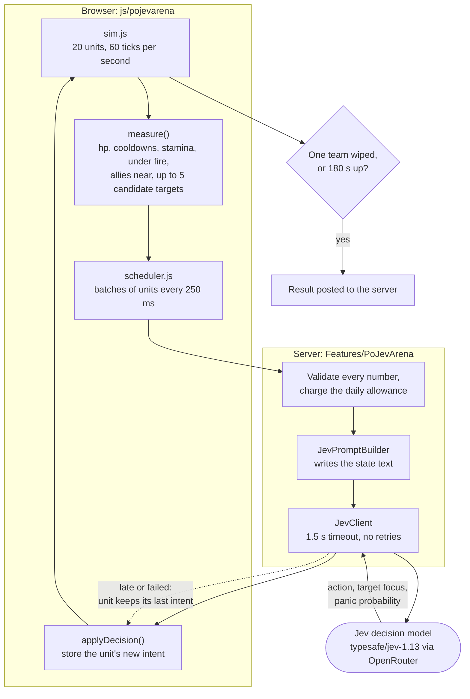
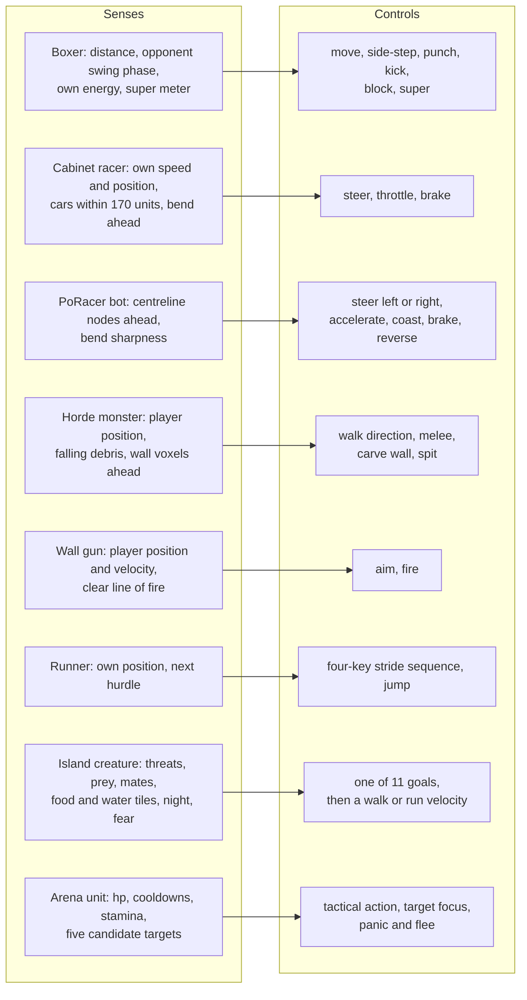
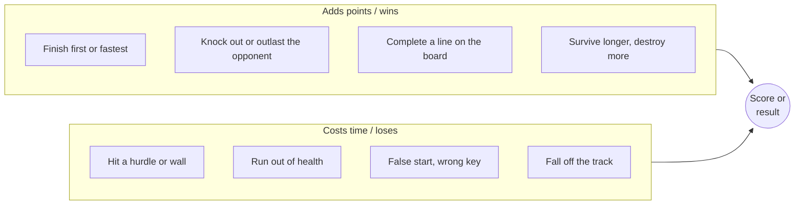
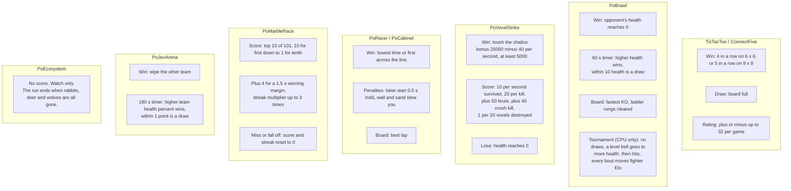
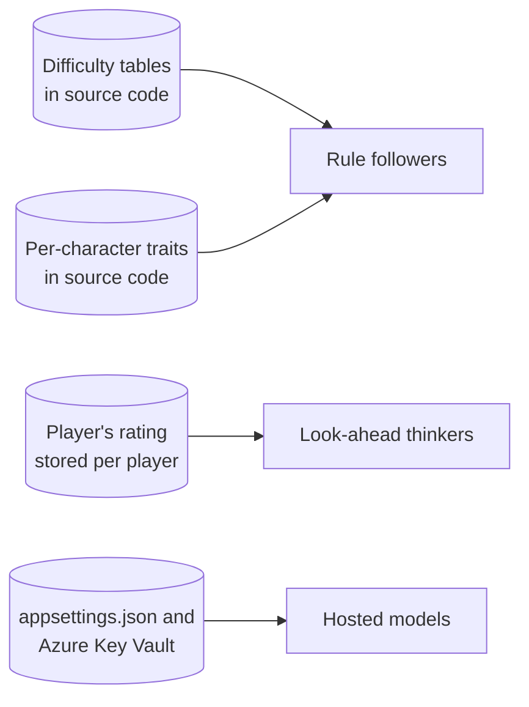
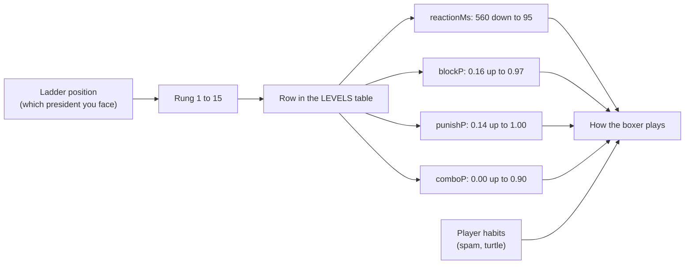

# Core Architecture & Game Loop

Snapshot date: 2026-10-03. Part of the `DOCS/20261003` set:
[model_summary.md](model_summary.md) · [training_metrics_guide.md](training_metrics_guide.md) ·
[creatures_dashboard.html](creatures_dashboard.html) · [scene_layout.html](scene_layout.html) ·
[creature_benchmarks.html](creature_benchmarks.html)

> **Read this first.** This doc set follows a template written for Unity ML-Agents projects.
> PoMiniGames is not a Unity project and contains **no trained models**: no ONNX files, no
> training runs, no reward curves. Every computer-controlled character here is either
> hand-written rules running in the browser or on the .NET server, or a hosted language model
> called over the network. Where the template asks for a training-only fact, the docs say
> "not applicable" instead of inventing a number. A "Unity equivalent" column is included so
> readers from that world can map the ideas across.

---

## Tier 1: Quick Look (30 seconds)

PoMiniGames is a website with fourteen small games. Twelve of them contain something that
plays without a human: a board-game opponent, a boxer, a racing driver, a horde monster, a
wolf on an island. None of them learned their behaviour. Designers wrote the rules and tuned
the numbers by hand.

There are three kinds of computer player:

| Kind | What it is | Where it runs | Examples |
|---|---|---|---|
| **Rule followers** | Fixed rules plus dice rolls. Difficulty is a table of numbers. | Player's browser | PoBrawl boxers, PoVoxelStrike monsters |
| **Look-ahead thinkers** | Try every move a few turns ahead and pick the best. | Player's browser | TicTacToe and ConnectFive opponents |
| **Hosted models** | A language or decision model answers a question over the internet. Opt-in only: each has a free default. | Cloud service, called by the server | Jev (battle tactics), the Fresh AI quiz writers, the couple-quiz AI judge |

Every one of them runs the same loop many times a second: **look, decide, act, check if the
round is over**.

What to know as a designer or producer:

- Changing how hard an opponent is means editing a row in a table, not retraining anything.
- Only the hosted models cost money per decision, and only when a signed-in player opts in.
  Each has a daily cap and a free fallback (question banks, free answer matching, the local
  Jev rules). Ecosystem, Brawl and Cabinet text is scripted and calls no model.
- The only stored performance data in the repo is five recorded PoCabinet laps used by tests. They are regenerated with `scripts/pocabinet/gen.mjs` whenever either physics copy changes on purpose.

---

## Tier 2: Core Mechanics

### 2.1 The Decision Loop

**High-level view.** Every agent in the project fits this shape.



**Component-level view: a rule follower (PoBrawl boxer).** The engine asks each fighter's
controller for an "intent" 60 times a second. The controller never touches physics itself.



**Component-level view: a look-ahead thinker (ConnectFive opponent).**



**Component-level view: a hosted model (Jev in PoJevArena).** The browser simulates the
fight; the brain only answers "what should this unit do next?". The default brain is the free
rule-based `LocalJevClient` on the server (once per unit per second). Paid Jev answers only when
`PoMiniGames:Jev:Brain` is `Jev`, a key is set and the player picks Jev in Settings; then a unit is
asked only on a state change (target lost, HP band crossed, new threat within 6 m), at most every
2 s, and repeated situations are answered from a per-match cache. An opt-in on-device model
(`js/localAi.js`, WebLLM over WebGPU) can serve the Jev brain in the browser instead.



**Engine mapping.**

| Concept | In PoMiniGames | Unity equivalent |
|---|---|---|
| The agent | A JS class (`AiController`, `AiTypist`, `Enemies`) or C# class (`TicTacToeAI`, `PoRacerAiDriver`) | `Agent` MonoBehaviour |
| Sensors | A plain object built each tick from game state (`_aiContext`, `perceive`, `measure`) | `RayPerceptionSensor`, `CollectObservations` |
| Brain / policy | Hand-written rules, a search, or a web call | `.onnx` model in Behavior Parameters |
| Actions | An "intent" object, a board move, or a key press | `OnActionReceived` |
| Physics | cannon-es (PoBrawl ragdolls, PoVoxelStrike player, PoMarbleRace) or custom arcade maths | Rigidbody, ConfigurableJoint |
| Episode reset | Round / match / race restart; demo modes loop on their own | `EndEpisode()` |
| Decision period | The tick rate plus any reaction-time gate | Decision Requester |

### 2.2 Controls & Movement Map

**High-level view.**

```mermaid
flowchart LR
    subgraph Senses["What agents sense"]
        P["Positions and distances"]
        V["Own speed and heading"]
        O["Obstacles, walls, track shape"]
        T["Opponent's current move<br/>and timing"]
        N["Needs: hunger, thirst,<br/>stamina, health"]
    end
    subgraph Controls["What agents control"]
        M["Move direction and speed"]
        ST["Steer, throttle, brake"]
        AT["Attack, block, special"]
        J["Jump"]
        BM["Board move"]
        K["Key presses"]
    end
    Senses --> BR(("Brain")) --> Controls
```



**Component-level view.** Each row is one agent family.



How movement reaches the engine:

| Agent | Movement type | What that means |
|---|---|---|
| PoBrawl boxer | Kinematic | Velocity is eased toward the intent and the position is written directly. Physics only takes over for the KO ragdoll. |
| PoVoxelStrike monsters | Direct position | No physics body. The mesh is moved each frame and settles onto the terrain height. |
| PoCabinet racer | Custom arcade car | Speed along the heading; turning limited by grip. Barrier hits and contacts cost structure, engine and alignment (`hurt()` in `physics.js`, `PoCabinetPhysics.Hurt`): a bent car pulls and loses lock, power, top speed and grip, and a wrecked one limps off the line and is out (DNF). Hills are physics too (the Marble Run): gravity along the grade (`SLOPE_GRAVITY` 60) speeds a car downhill and slows it uphill, drag past top speed tops a descent out, a banked turn adds grip, and braking takes cornering grip (a friction circle). The AI brakes only for corners and traffic, so a descent can carry it up to 30 u/s over its own pace. |
| PoRacer bot | Custom arcade car | One circle per car; on-or-off steering and pedals. |
| PoMarbleRace marble | Physics body | A rolling sphere. No brain: gravity and the track do everything. |
| PoEcosystem creature | Kinematic over a heightmap | Velocity intent with fallback headings when blocked. |
| PoJevArena unit | Force-based 2D | Leg force limited by grip and stamina. |

### 2.3 Goals & Scoring Rules

**High-level view.** Nothing is "rewarded" in the training sense. These are the game's own
win, lose and score rules, which are what a trained agent would have been scored on.



**Component-level view.**



### 2.4 Tuning Settings

**High-level view: where the knobs live.**



**Component-level view: one knob traced end to end (PoBrawl difficulty).**



**The configuration table.** The left column uses the plain-language names from the training
world. The middle column is the closest real setting in this project.

| Plain-language setting | Training-world name | Closest equivalent here | Value(s) | Where |
|---|---|---|---|---|
| **Learning pace** | Learning rate | Nothing trains. Closest: how fast the board-game CPU's strength follows the player's rating. | `AdaptiveK = 32` | `Client/Services/Play/GameStatsService.cs` |
| **Learning pace (generations)** | Mutation rate | How much a newborn island creature's personality differs from its parents. | `TRAIT_MUTATION_SIGMA = 0.08` | `js/poecosystem/sim/core/config.js` |
| **How far ahead it plans** | Time horizon | Moves searched ahead on the board. | 4 (TicTacToe hard), 1 to 4 (ConnectFive by rating) | `TicTacToeAI.cs`, `ConnectFiveAI.cs` |
| | | Distance a racer looks down the road. | 25 to 130 units per official (PoCabinet); 9 to 24 track segments (PoRacer) | `js/pocabinet/physics.js`, `PoRacerSim.cs` |
| **Memory size** | Buffer / memory size | Positions the board search remembers. | 2048 (ConnectFive) | `NegamaxSearch.cs` |
| | | How long an island creature remembers food and water. | 120 s food, 240 s water | `js/poecosystem/sim/core/config.js` |
| | | How long a boxer remembers the player's habits. | `HABIT_TAU = 8` s | `js/pobrawl/ai.js` |
| **Exploration rate** | Epsilon / entropy | Chance the board CPU plays a random move on purpose. | 0.55 down to 0.05 (TicTacToe); 0.60 down to 0.00 (ConnectFive) | `StrengthForElo` in each AI file |
| | | Chance a PoCabinet racer misjudges a corner and runs off the road. | `wildness` 0.03 to 0.14 for the four officials, 0.05 to 0.25 for the field (every car has some) | `js/pocabinet/physics.js` |
| | | Steering wobble on a PoRacer bot. | `0.015 x (1.15 - CorneringSkill)` per tick | `PoRacerSim.cs` |
| **Reaction time** | Decision period | Delay before a boxer makes a weighted choice. | 560 ms (rung 1) down to 95 ms (rung 15) | `js/pobrawl/ai.js` |
| **How often it thinks** | Decision frequency | Ticks per second. | PoBrawl 60, PoJevArena sim 60 (one model call per unit per second), PoRacer 50, PoCabinet 30, PoEcosystem 20 (goals re-scored 4 times a second) | each engine's constants |
| **Batch size** | Batch size | Units sent to Jev per request. | `MaxBatch = 8` | `PoJevArenaEndpoints.cs` |
| **Aggression** | Reward weight | Boxer's attack appetite. | `aggro` 0.72 to 1.50 | `js/pobrawl/ai.js` |
| | | PoRacer bot's risk on corners. | `Aggression` 0.30 to 0.95; tier `botCaution` 0.58 / 0.42 / 0.20 | `PoRacerAiDriver.cs`, `PoRacerRaceRegistry.cs` |
| **Spending cap** | Compute budget | Hosted-model tokens per player per day. | `DailyTokensPerIdentity = 250000` | `appsettings.json` |
| | | Jev decisions per player per day. | `DailyCallsPerIdentity = 5000` | `appsettings.json` |
| **Give-up time** | Timeout | Longest a hosted-model call may take. | 20 s total (chat models), 1.5 s (Jev) | `AzureOpenAIResilience.cs`, `JevOptions.cs` |

---

## Tier 3: Setup Guide

### 3.1 Run it

```powershell
docker compose up -d azurite
dotnet run --project src/PoMiniGames.API/PoMiniGames.API.csproj
# open http://localhost:5080
```

Every game has a demo mode where the computer plays both sides. That is the quickest way to
watch an agent without touching anything.

### 3.2 Change how hard an opponent is

There is no inspector panel. Settings are constants in source files; edit, rebuild, reload.

| To change | Edit | Notes |
|---|---|---|
| PoBrawl difficulty curve | `LEVELS` in `wwwroot/js/pobrawl/ai.js` | One row per rung. `reactionMs` lower is harder; the `P` values are chances from 0 to 1. |
| A president's fighting style | that president's block in `wwwroot/js/pobrawl/personalities.js` | `footwork`, three `aiPatterns`, and a `super`. The schema is documented at the top of the file. |
| A president's body | `wwwroot/js/pobrawl/fighters.js` | `heightScale`, `buildScale`, `mass`, `attackPower`, `moveAccel`. |
| Board-game CPU strength | `StrengthForElo` in `TicTacToeAI.cs` / `ConnectFiveAI.cs` | Rating thresholds map to search depth and blunder chance. |
| Horde monsters | `ARCHETYPES` in `wwwroot/js/povoxelstrike/enemies.js` | `hp`, `speed`, `meleeDamage`, `spitInterval`. Spawn pacing is in the spawn director below it. |
| Wall guns | constants at the top of `FortressGuns` in `wwwroot/js/povoxelstrike/fortress.js` | Range 120, reload 2.2 s, spread 0.035 rad. |
| PoCabinet officials | the roster in `wwwroot/js/pocabinet/physics.js` **and** `PoCabinetSim.cs` | The two files are a line-for-line mirror. Change both or the lap verifier will reject laps. Each driver has eight traits (line, lookahead, braking, collision tolerance, drafting, wildness, `aggression`, `twitch`); a bruiser (aggression ≥ 0.8) follows close enough to bump and turns in on a car alongside. `archetype()` names a driver's strongest trait for the standings (display only). |
| PoCabinet damage | the damage constants at the top of `physics.js` **and** `PoCabinetPhysics.cs` | Same mirror rule: `DAMAGE_FLOOR` 12 u/s is shrugged off, `DAMAGE_SCALE` 9500 is the squared excess that wrecks a car. Changing either means regenerating `tests/Shared/Fixtures/pocabinet-lap-proofs.txt`. How it looks (dents, loose parts, smoke) is `cars.js` / `fx.js` and never touches the sim. |
| PoCabinet track features | a track's definition in `PoCabinetTrackGeometry.cs` (`KnotZ`, `KnotBank`, `KnotWidth`, `Runoff`, `Sausages`, `Patches`, `Islands`, `Theme`); the daily circuit is generated by `PoCabinetDailyTrack.cs` | `PoCabinetTrackFeatures` turns them into per-sample arrays shipped in the static world (half width, run-off 0 grass / 1 gravel / 2 tarmac, kerbs ±1 flat / ±2 raised, racing line, patches, dividers), so `PoCabinetTrack` and `track.js` read the same values and nothing is derived twice. The physics is mirrored as before: gravel `GRAVEL_GRIP` 0.45 and `GRAVEL_DECEL` 95, gravel and tarmac run-off 40 deep (grass 26), a raised kerb scrubs 45 u/s² and kicks the car out, rubber adds up to 5 % grip on the line over 90 s (10 % in the wet, where the line dries first), dividers taper over 4 samples and the AI keeps to the middle of its lane beside one. Track limits (`beyondLimits`: the car's flank past the edge, a kerb counts as track) void the lap in `race.js`, `PoCabinetSim` and `PoCabinetLapVerifier`. Any change means regenerating the lap proofs with `scripts/pocabinet/` (see its README). Track geometry uses `PoCabinetDetMath`, never `Math.Sin` or `Math.Atan2`: the browser (Mono WASM) and the server build the same world from the id, and must agree to the bit. |
| PoCabinet demo TV coverage | constants at the top of `wwwroot/js/pocabinet/broadcast.js` | Demo mode only. The director holds a shot 6 to 15 s, a fight is two cars under 1.0 s apart (dropped past 1.6 s), and events (new leader, wreck in the top 15, the flag) take over after 2.5 s. It reads the race and never steps it, so no mirror and no lap-proof impact. The picture-in-picture is `setPip` in `scene.js` (a second scene render into an HDR target, tone-mapped into its corner by `postfx.js drawInset` so it shares the main pass's shader programs; off on the low tier and under 560 px). |
| PoCabinet graphics and sound FX | `postfx.js` (`PASSES`, `AO_RADIUS`, `SHUTTER`, `MAX_BLUR_PX`), `gpuParticles.js`, `debris.js` (tier caps), `paint.js`, `slipstream.js`, `music.js`, `acoustics.js` | All render or audio only, never the sim, so no mirror and no lap-proof impact. Post (medium/high; low is unchanged): GTAO from the resolved depth, screen-space reflections where the scene's alpha marks a surface reflective (`materials.js reflective()`/`mirrorDecal()`: the road, puddles), raindrop ripples, a heat mirage on the far dry road, per-object motion blur (high) from a car velocity buffer, exhaust heat haze. Smoke, dust and fire are 32k (high) / 8k (medium) GPU particles in float ping-pong textures with curl noise, car wakes and sun self-shadowing (low keeps the CPU pools). Shunts throw rigid-body debris (custom impulse solver, 24/64/160 pieces). Cars gather dirt, rain beads and paint scars. The tow (`fx.draft`) draws streamlines and fills the gauge's `--tow` arc. Audio: an adaptive synthesized score (the `music` setting), convolution reverb zones (stand, gantry/bridge/walls, open) and surface tyre beds. |
| PoRacer bots | `PoRacerAiDriver.cs` (personalities), `PoRacerRaceRegistry.cs` (tier pace and caution) | Server-side only. |
| Island creatures | `wwwroot/js/poecosystem/sim/creatures/species.js` and `sim/core/config.js` | PoEcosystem is watch-only by design; tune numbers, do not add player controls. |
| Arena creatures | `Shared/Games/PoJevArenaShared.cs` | Presets, ability costs, build budget of 80. |

### 3.3 Joint limits

Only two games have jointed bodies, and in both the joints are for falling over, not for
walking.

| Rig | Parts | Joints | Limits (cone / twist, radians) |
|---|---|---|---|
| PoBrawl KO ragdoll (`ragdollPhysics.js`) | 11 boxes | 10 cone-twist | waist 0.50 / 0.40 · neck 0.80 / 0.80 · shoulders 1.20 / 0.50 · elbows 0.90 / 0.30 · hips 1.00 / 0.40 · knees 0.90 / 0.25 |
| PoEcosystem biped ragdoll (`sim/physics/ragdoll.js`) | 7 boxes | 6 cone-twist | not listed here; see the file |
| PoEcosystem quadruped ragdoll | 6 boxes | 5 cone-twist | not listed here; see the file |

Everything else is a single body with no joints: a sphere (marbles, the PoVoxelStrike
player), a circle (PoRacer cars, arena units), a capsule (PoCabinet cars), or no physics
body at all (horde monsters, runners, living island creatures).

### 3.4 Hosted-model settings

Settings live under `PoMiniGames:AI` and `PoMiniGames:Jev` in `appsettings.json`, with
secrets in Azure Key Vault. Do not use `dotnet user-secrets` in this repo.

| Setting | Meaning |
|---|---|
| `PoMiniGames:AI:FoundryEndpoint` | Where the chat models live (Key Vault secret). |
| `PoMiniGames:AI:DefaultDeployment` | Model used when a game has no specific entry. |
| `PoMiniGames:AI:Deployments` | Map of `game` or `game.task` to a model name, for example `couplequiz.similarity`. |
| `PoMiniGames:AI:TokenBudget:DailyTokensPerIdentity` | Per-player daily spend cap. 0 turns it off. |
| `PoMiniGames:AI:QuizPrebake:*` | Background PoFunQuiz bank filler: `Enabled`, `Interval`, `Categories`, and `AllowAiTopUp` (off; the only part that spends). |
| `PoFunQuiz:QuestionSource` / `AllowFreshAi` / `BankTargetPerCategory` | `Bank` (free, default) or `FreshAi`; Fresh AI is served only to signed-in players while allowed. `PoFunQuiz:OpenTriviaDb:*` tunes the free source. |
| `PoCoupleQuiz:Features:QuestionSource` / `AllowFreshAi` / `AnswerMatching` / `AllowAiJudge` | `Bank` and `Smart` (free `AnswerMatcher`) by default; `FreshAi` and `AiJudge` apply only to a signed-in host. |
| `PoMiniGames:Jev:Brain` | `Local` (free rules, the default) or `Jev` (paid; also needs `ApiKey` and the player's opt-in). |
| `PoMiniGames:Jev:Model` | Pinned to `typesafe/jev-1.13`. |
| `PoMiniGames:Jev:CallTimeoutMs` | 1500. A late answer is dropped and the unit keeps its last order. |
| `<Game>:Features:UseMockAI` | Use canned answers when a paid path is chosen. Honoured only outside production. Tests force it on, and `appsettings.Development.json` turns it on for PoFunQuiz and PoCoupleQuiz so local runs spend nothing. |

Both quizzes and their answer-similarity scoring point at `gpt-5.4-nano`, the cheapest
model in `ModelPricing.cs`. The process-local usage, cost and caller-budget read-model is
`GET /api/diag/ai` (the AI half of `/api/diag`).

#### Free external content: PoBrawl fighter dossiers

`GET /api/pobrawl/dossier` (anonymous, like the leaderboard reads) returns one dossier per
fighter: the fifteen presidents in ladder order, then BOB. The static facts (number, term,
party, a fighting-style line restating `personalities.js`, and BOB's made-up dossier) live in
`Shared/Games/PoBrawlDossier.cs`. `PoBrawlDossierService` adds each president's summary
(two sentences, at most 300 characters), portrait thumbnail and article link from the free
Wikimedia REST API (`/api/rest_v1/page/summary/{title}`). It sends a descriptive User-Agent,
uses the standard resilience handler, and caches the list in memory for
`PoMiniGames:PoBrawl:Dossier:CacheHours` (24). A partial fetch is cached for 15 minutes.
`PoMiniGames:PoBrawl:Dossier:FetchWikipedia` (default true) switches the call off. Off, or on
any failure, the static facts are served, never a 500. Every test host pins it to false in
`TestBudgetGuard`. Wikipedia text is CC BY-SA 4.0, so `PoBrawlDossierCard` shows a
"From Wikipedia" link and the licence next to it. The card appears on the 1P scouting card
and the 2P fighter select, behind a "Dossier" disclosure.

#### AI provider recipes

The quizzes play from their free banks by default. Development also sets the mock AI flags, so
even a Fresh AI or AI-judge request never calls a paid model locally,
even though `KeyVault:Uri` can resolve the shared Foundry endpoint. To try real model output
locally, opt in deliberately: set `PoFunQuiz:Features:UseMockAI` and/or
`PoCoupleQuiz:Features:UseMockAI` to `false`, and point the AI section at one of these.

- **Ollama (free, local, the recommended opt-in).** Run `ollama pull qwen3:4b`, then set
  `PoMiniGames:AI:FoundryEndpoint=http://localhost:11434/v1`, `Provider=openai`,
  `DefaultDeployment=qwen3:4b`, and clear the `Deployments` map so every game resolves the
  default. No key and no network. Add `ModelCapabilityOverrides={"qwen3:4b":"basic"}` if a
  structured-output call starts returning 400: the name heuristic assumes `qwen*` speaks
  `json_schema`, which older Ollama builds do not.
- **Gemini (paid, separate quota).** Google's OpenAI-compatibility endpoint is cheaper per
  token on the Flash-Lite tier: `FoundryEndpoint=https://generativelanguage.googleapis.com/v1beta/openai/`,
  `Provider=openai`, `ApiKey=<AI Studio key>`, `DefaultDeployment=gemini-2.5-flash-lite`.
  `AiModelCapabilities` already classifies `gemini-*` as conventional (json_schema and
  temperature, no reasoning_effort).
- **Embeddings for PoCoupleQuiz similarity.** An embedding deployment is the cheapest fix for
  answer scoring and does not need Azure: `ollama pull nomic-embed-text` plus
  `EmbeddingDeployment=nomic-embed-text` on the openai provider makes similarity scoring
  free, deterministic and permanently cacheable. `AiEmbeddingService` is provider-neutral.

### 3.5 Known gaps worth fixing before relying on these docs

Found while reading the code for this snapshot:

- **No strength tests exist** for either board-game opponent.
- ConnectFive declares an 8-second thinking budget (`AiMoveBudgetMs`) that nothing enforces.
- PoVoxelStrike monsters and PoRacer steering wobble use unseeded randomness, so their runs
  cannot be replayed exactly.
- PoBrawl demo mode can pair in BOB, whom the server's rating endpoint rejects.

### 3.6 MarbleRace physics: Rapier migration plan

Status (2026-10-17): **planned, not started.** PoMarbleRace still runs on cannon-es 0.20.0, and
every other 3D game keeps cannon-es too. The swap was investigated and deliberately not
half-done: it cannot be verified without a browser, and a partial switch would leave two
physics engines fighting over the same marbles.

**Why switch.** cannon-es steps a variable number of substeps per frame (`stepWorld` in
`pomarblerace/physics.js` throws away the time it cannot catch up) and promises nothing about
identical float results across browsers. That is why online play is a host-authoritative relay
(`PoMarbleRaceShared.cs`: the host simulates, streams 101 positions at 15 Hz, the guest only
steers) and why the ghost of your best run (F5, `ghostTrack.js`) is a recorded *path* rather than
a replayed input log. Rapier's WASM build steps the same inputs to the same result on every
machine, which would let a ghost, a guest and the server all share one simulation.

**What it touches.** cannon-es is not wrapped behind an interface; game code reads and writes
cannon bodies directly.

| File | cannon-es use |
|---|---|
| `physics.js` | world, gravity, solver, seven contact materials (friction and restitution per pair) |
| `marbles.js` | 101 sphere bodies, mass spread, damping, `body.velocity` / `position` / `quaternion` |
| `track-glb.js` | chunked `CANNON.Trimesh` colliders (Int16 index cap, octree patch), static bodies |
| `track-procedural.js` | boxes, spheres, hinged turnstile paddles with motors (`driveMotors`) |
| `game.js` | steering, boost, brakes, kickers and unstick all add to `body.velocity`; `world.contacts` drives the on-track test, the elimination sweep and the audio surface |

**Plan, in order. Each step ships on its own and keeps online play working.**

1. **Physics port behind a seam.** Add `pomarblerace/physics-api.js` with what game code needs:
   `addSphere`, `addTrimesh`, `addBox`, `addHinge(motor)`, `velocity(body)` / `setVelocity`,
   `position`, `rotation`, `contactsOf(body) → material names`, `step()`. Implement it on
   cannon-es first and move every direct `body.*` and `world.contacts` access in `game.js`,
   `marbles.js` and the two track builders onto it. No behaviour change; this is the large,
   reviewable part.
2. **Fixed step, input-driven.** Replace the frame-dt accumulator with whole fixed steps at
   1/60 s and a step counter. Slow motion and hit-stop change how many steps a frame runs, never
   the step size. Steering, boost and kickers are applied per step from the step counter, not
   from wall time. The one `Math.random()` that touches play (the demo's random pick) takes a
   seeded generator; spark spawning stays random because it is visual only.
3. **Rapier implementation of the seam.** Load `@dimforge/rapier3d-compat` pinned to one exact
   version (for example `0.14.0`) from `cdn.jsdelivr.net/npm`, by a dynamic `import()` inside the
   MarbleRace engine only, never through the shared import map, so the other games never fetch
   it. `await RAPIER.init()` before the first `Game` is built (index.js `start()` already awaits
   the map load, so it goes there). Map cannon's pieces: sphere bodies to
   `RigidBodyDesc.dynamic()` + `ColliderDesc.ball`, trimesh chunks to `ColliderDesc.trimesh`
   (no Int16 cap, so the chunking can be relaxed), paddles to a revolute joint with a motor,
   contact-material pairs to per-collider friction/restitution with `CoefficientCombineRule`, and
   `world.contacts` to `world.contactPairsWith`. Enable CCD on marbles; the speed clamp and
   `sweepGuard` stay until measurements show CCD alone holds the shell.
   Cross-browser bit-exactness needs Rapier's enhanced-determinism build; check which compat
   package exposes it at the pinned version before relying on lockstep (step 6).
4. **Retune and verify headless-free.** A node test (`tests/pomarblerace-physics.test.mjs`)
   loads the compat build (it inlines its WASM, so node can run it), builds the procedural chute
   from a fixed seed with no renderer, steps 60 s of race twice and asserts identical marble
   positions, then checks the course invariants the cannon tuning was written for: no marble
   trapped on the shallowest descent (friction bracket 0.077–0.11 in `physics.js`), none
   tunnelling at 120 u/s, the field finishing inside `RACE_TIMEOUT`. Then one recorded headless browser
   pass per map for frame cost: 101 marbles against a trimesh course cost ~16.5 ms a step on
   cannon-es, and Rapier has to come in under that or the race runs in slow motion.
5. **Switch the default, keep a flag.** `?physics=cannon` keeps the old engine for one release;
   ghosts recorded on cannon stay valid because they are paths, not input logs.
6. **Then, and only then, lockstep.** With a deterministic step, online can send steering
   inputs per step instead of 101 positions at 15 Hz, and the ghost can become an input log
   replayed through the real simulation. Keep the relay as the fallback until both browsers'
   step checksums have been compared in production for a while.

**Online today, unchanged by any of this until step 6:** the host's `_netSend` streams Float32
positions plus a flag byte per marble through `PoMarbleRaceOnlineHub`; the guest eases toward
them in `_guestRacingFrame` and runs no physics at all.

### 3.7 PoBrawl online: rollback netcode

The online 1v1 is GGPO-style rollback with the server as input relay and referee. The fight
the result depends on (HP, energy, spacing on a one-dimensional ring, swings that hit, are
blocked or whiff, the KO and the bell) is a small integer simulation that runs in three places
at once and must give bit-identical results everywhere.

| Piece | Where | What it does |
|---|---|---|
| Sim (C#) | `Shared/Games/PoBrawlRollbackSim.cs` | 60 Hz frame step over a 26-int state: millimetres, energy in sixths of a point, a mulberry32 damage roll seeded by FNV-1a of the match id. No floats. |
| Sim (JS) | `wwwroot/js/pobrawl/rollbackSim.js` | The same rules, line for line. A golden input script pins the final checksum in both test suites (`PoBrawlMatchServiceTests`, `tests/pobrawl-rollback.test.mjs`). |
| Referee | `Features/PoBrawl/Online/PoBrawlMatchService.cs`, `PoBrawlMatchPump.cs` | Runs the C# sim on a Stopwatch clock (a catch-up loop, because Windows timers tick at ~15.6 ms). An input stamped for frame f is applied at max(f, server frame + 1) and never earlier than that side's previous input; the server never rewrites its own past. Owns presence, forfeits, rematches and the result. |
| Relay | `PoBrawlMatchHub.cs` | `SubmitInput` → `matchInput` to the whole group, sender included, carrying the frame actually used. `Ping` returns the server's frame clock. The pump sends `matchState` (full sim state, frame, checksum, presence) every 6th frame (10 Hz). |
| Rollback | `wwwroot/js/pobrawl/rollbackSession.js` | Local input applied 2 frames ahead (`INPUT_DELAY`) and sent. Remote input predicted as "keep holding, press nothing". A late confirmed input rolls back to its frame and re-simulates from a 128-frame state ring (~2 s). A snapshot whose checksum differs from history replaces it and re-simulates. |
| Presenter | `wwwroot/js/pobrawl/netplay.js` | Shows the session's state every render frame: fighters steer to the sim's X, each (corner, frame) swing is thrown once with the sim's verdict, HP and energy come from the sim, and a predicted KO waits for the server's word before it plays. |
| Net FX | `netplay.js`, `postShader.js` (`uNetSmear*`), `PoBrawlNetMeter.razor` | Presentation of corrections, never the sim: the session's `onCorrection` hook reports how far a re-simulation moved each corner; past 120 mm that fighter closes the gap in ~3 frames under a directional chromatic smear. A swing whose frame is past `session.confirmedFrame` (the newest snapshot) trails a faint cyan ghost until confirmed. At 2 Hz the engine pushes RTT, rollbacks + corrections per second and the deepest rollback to `PoBrawlPage.OnNetSignal`, shown as four signal bars with the numbers in the tooltip. |

Clock sync: a player runs ahead of the estimated server frame by RTT/2 plus one frame, so its
inputs arrive before their frame comes up. A spectator runs behind by RTT/2 plus four frames,
so it almost never predicts. Ping samples come in every 200 ms at first, then every second. The
offset comes from the fastest sample and the RTT from the median. A new estimate is slewed in at
2 frames a second (an occasional doubled or skipped frame), and an error above 30 frames jumps.

Anti-cheat stays where it was: the server pins each connection to its corner at `JoinMatch`, a
client only ever sends inputs, and the result comes from the server's copy of the sim alone.

### 3.8 Game feel: haptics and the super ink shift

**Haptics.** `wwwroot/js/impactBus.js` is the one gate for every rumble and vibration:
`gateRumble` / `playRumble` (controller `dual-rumble`) and `vibrate` (phones). It honours the
Haptics setting (`pomini_haptics`, default on; `SettingsService.SetHapticsAsync` →
`appPrefs.applyHaptics` stops a running motor at once), treats reduced motion as *reduced*
haptics (half strength, shorter, "ambient" effects dropped), skips the attract reel and hidden
tabs, and caps each pad at 600 ms of motor time per second, 700 ms per effect, with a weaker
effect never cutting off a stronger one (a KO's `priority` thud may borrow past the duty cap).
Games that call `playEffect` or `navigator.vibrate` themselves are covered by a prototype gate.
`impact()` maps each preset to a rumble scaled by hit weight unless an engine has called
`claimHaptics()`; PoBrawl does, and `js/pobrawl/haptics.js` routes its own: only a human
corner (online: the local one; never demo, tournament or a spectator), on that corner's pad or,
for player 1, the phone. Charge = a rising pulse train (~8 Hz), perfect guard = a sharp tick,
landed hits = thumps scaled by damage, KO = a 650 ms thud.

**Super ink.** While a signature super fires, `personalityEffects.js` eases `uSuperInk` in the
post pass (`postShader.js`) up over 180 ms, holds 0.5 s and eases out over 320 ms: the frame
prints as a two-tone page in the president's suit and tie colours with Ben-Day dots, paper
grain, thick ink edges and speed lines out of the firing fighter. Every layer keeps each
pixel's brightness, per spectacle.js's flicker rule. Reduced motion gets a weaker, shorter,
motionless version; the low tier skips the edge taps and grain. Wall clock, no match RNG.

**Tournament night.** The CPU bracket (Brawl's Demo mode, `/pobrawl/demo`; `/pobrawl/tournament` is the old address, `PoBrawlTournamentPage`) hands the
engine each bout's round and Elo expectation (`PoBrawlTournament.ExpectedP1`, the board's
`EloMath` curve) as `PoBrawl.matchup`'s optional fifth argument `{ round, p1Expected }` (and the
same keys on `PoBrawl.init`). `js/pobrawl/cup.js` turns them into the night: golden-hour light
for the quarterfinals, dusk for the semis and a night final under tight spots and haze
(`arena.js ROUND_LOOKS`, eased over ~2 s; the low tier keeps the base haze), a hall that fills
round by round (`setCrowdFill`), and a live upset level from the expectation and the HP lead
that drives the crowd: murmurs and phones while the underdog leads, gasps on their heavy hits,
boos while a heavy favourite cruises, a roar and an "UPSET!" jumbotron caption for an upset,
and a stadium slap-back echo (`audio.js slapback`) on heavy hits in high-upset moments. In
this mode the mat wear, blood and broken crates are not reset between bouts (`resetProps`
`keepBroken`). Between bouts the page opens an animated bracket (winner's SVG wire burns
forward with a SMIL spark, Elo odometers, the loser's card cracks) and puts it on the arena
jumbotrons (`PoBrawl.jumbotronBracket`). After the final, `PoBrawl.ceremony(championId)`
(`ceremony.js`) lowers a procedural gold belt with an embossed seal plate onto the champion,
fires confetti cannons from the truss, pops flashbulbs in the stands and has the PA call the
champion, before the bracket and the result modal. Bracket "UPSET!" lines use
`PoBrawlTournament.UpsetBelow` (winner's expectation ≤ 0.45). Reduced motion: end states only,
a third of the confetti, no flashbulbs. No music: crowd, PA and effects only.

**Broadcast director camera.** In the CPU-only modes (demo, tournament) `js/pobrawl/director.js`
drives the 'normal' camera while the phase is 'fighting' (`cinematics.js _updateCamera` calls
`_directCamera`; the KO and super branches still win). It cuts between rigs computed from the
fighters' positions: the house framing, wide establishing, low ringside, over-the-shoulder, a
crane, a tight two-shot, a push-in on a fighter who drops into the red, and a 1.3-2 s crowd
cutaway. Shots run 2.5-7 s. A third hit in a run or a heavy hit tightens the shot, and an event
that lands before the minimum waits up to 1.6 s. About 18% of cuts are 0.24 s whip-pans
(radial blur + afterimage). Reduced motion uses 4.5-11 s shots with no cutaways and no
whip-pans. Shot choice uses `Math.random`, never the seeded match RNG. On the medium and high
tiers, and never on phones, an **iso cam** inset (22% of the width) shows a tight angle on the
fighter the main shot is not centred on. It is drawn after the composer: the scene renders into
a half-float target at 0.8x of the inset's pixels, at half rate, with no post and no
shadow-map re-render, then goes through its own OutputPass into a scissored corner. A drop to
the low tier pulls the inset until the next round. Toggles: `PoBrawl.setDirector(on)` and
`PoBrawl.setIsoCam(on)` (the tournament bar's "🎥" camera button; the init options
`director` and `isoCam`, which default to the Brawl show setting: on for Full, off for Simple), plus `PoBrawl.director()` for diagnostics.

**Side view for human modes.** 1P, 2P, online and training keep a plain side view
(`cinematics.js _sideView`): the boom sits straight out on the audience side of the pair's
midpoint, slides and zooms with them, and never orbits, springs on a hit or circles a super. The
circle keys still sidestep in depth, but `game.js` caps the depth offset between the two at
tan 30° of their side-on spacing, so the fighters can never stack one behind the other. The KO shot
still plays once the fight is over.

**Liquid-glass HUD.** `js/pobrawl/hudLiquid.js` draws the fight HUD's health as liquid in a
glass tube and energy as plasma: one WebGL2 canvas over `PoBrawlHud`, one SDF fragment shader,
four scissored draws per frame. It reads the four meters' `aria-valuenow` and the danger /
energy-state classes through a MutationObserver, so the engine's 4 Hz pump costs no extra
interop and the thresholds stay in C#. Between pumps it eases the level, sloshes the front and
surface in proportion to the damage, and lets the lost slice hold 0.45 s and drain with drips;
at 25% health or less the liquid boils and the glass cracks, and a full energy tube crackles.
The CSS bars and `role="meter"` tracks stay in the DOM and are what shows without WebGL2 or on
the low tier (the HUD carries `data-liquid` only while the canvas draws). Reduced motion gets
still tubes redrawn on change. The loop pauses off-screen and in hidden tabs.

**Engine files.** `game.js` holds `BrawlGame`'s loop, spawning, the tick and teardown; everything
else is a prototype mixin (`mixin.js`) in its own file. Since 2026-10-18 that includes
`reactiveArena.js` (jumbotron, rig lenses, mat ripple and wear), `lighting.js` (house lights, posture,
blob and AO shadows) and `hudFeedback.js` (banner, combos, damage numbers, the HUD pump). Shared
match constants live in `constants.js`. The `AudioBus` is split the same way: `audio.js` (bus, SFX,
mix, crowd, Cup storyline), `audioAnnouncer.js` (the PA), `audioShowtime.js` (the show-bus half) and
`audioCore.js` (constants, tables and node helpers the three share). On the page side,
`PoBrawlPage.razor` keeps the markup and render fragments and `PoBrawlPage.razor.cs` the logic.
`PoBrawlProgressBook.cs` is the one reader and writer of the browser's ladder rung, fastest KO,
clears and Cup titles, merging the signed-in copy with `PoBrawlProgressDto.Merge` (the server
store's own rule).

**Showtime layer.** `js/pobrawl/show.js` is an event bus the presentation modules hang off, so
none of them patches the fight code. The engine emits `countdown`, `fight`, `chargeStart`,
`release`, `hit`, `block`, `super`, `ko`, `replay`, `result`, `cut` and `reset`. Each module
registers handlers, a per-frame update, an after-render hook (the frame is still readable there)
and a dispose. A throwing handler is logged and skipped. Every module uses `Math.random`, never
the seeded match RNG, builds its materials at boot so `_warmupRender` compiles them, and scales by
tier and reduced motion. All of them together cost about 0.7 ms a frame on the high tier.

**Simple and Full show.** The settings sheet's "Brawl show" row (`Games/PoBrawl/PoBrawlShowPrefs.razor`,
localStorage `pobrawl_show` = `full` | `simple`) picks how much of this runs; Simple is the default.
`show.js` reads it once per engine (`fullShow()`, `_fullShow()`). Simple registers only
`audioShow.js` and `chargeAura.js`, the two that carry fight information. Full adds the balloon
drop, LED boards, instant replay and result glass, and turns on the KO shatter and pyro
(`_presentResult`), the comic KO words and the crowd's camera flashes (`spectacle.js`), the belt
ceremony (`ceremony.js`, whose belt is not even built in Simple), the director's default in Demo
(`director.js`), the Cup's starting camera and the 1P campaign-map interlude between rungs. The
result itself is always the page's one result card (line, recap, press, KO clip); the old
"Breaking News" lower third (`news.js`) repeated the recap and was removed on 2026-10-18.

| Module | What it does |
|---|---|
| `audioShow.js` + `audioShowtime.js` | A silent conductor clock, published as `this.beat` (`bpm`, `phase`, `beatN`, `bar`, `pulse`, `energy`). A per-fighter charge riser with a full-charge glint and a release snap. A 4-7 note motif per president, played at the countdown, on supers and in the winner's fanfare; the belt ceremony gets a flourish. Combo notes and the stab when the lead flips snap to the beat. The mix follows the director's shot (tight, mid, wide, KO). In player modes the AudioListener follows the camera (HRTF on the high tier). The crowd stomps and claps on the beat when energy is high and chants a formant-synth "U-S-A!". `balloonPop()` is the balloon pop. There is still no music bed. |
| `chargeAura.js` | A fresnel energy shell on the striking fist or shoe while a strike charges, going from white to gold, with heat shimmer, motes from the shared particle pool, a full-charge star glint and a release flare. |
| `balloons.js` | Full show only. A convention balloon drop: 60 instanced balloons, sized by tier. Half of them drop on a KO win, all of them on the tournament final or the last ladder rung. Balloons float down buoyantly, collide through a spatial hash, are shoved by fighters and pop on hits. Pleated bunting and pennant strings run on Verlet cloth and kick on hits and the KO. Test hook: `_balloonDrop(n, spread)`. |
| `ledBoards.js` (+ `arena.js` `uWave`) | Full show only. Dot-matrix LED ribbon boards on the apron skirt and a ringside barrier. One shader scrolls a canvas marquee that is redrawn only when the text changes. It shows names, the popular-vote split, combos, BLOCKED, super names, KNOCKOUT, COMEBACK!, FINAL 10 SECONDS and UPSET ALERT, in the colour of the momentum leader. The truss and boards pulse on `beat.pulse`. A stadium wave rolls round the stands, lifting seats and phone lights. |
| `replay.js` | A preallocated ring buffer of every joint and root, about 4 s at 60 Hz. After a KO (not on a TIME decision, online, in training or under tournament fast-forward) a new `replay` phase runs between `ko` and `result`. It opens with a seal wipe and an "INSTANT REPLAY" bug, plays a wide angle at 1x and then the impact at 0.3x under a telestrator circle and arrow, and restores the live pose and camera exactly. Any key, tap or click skips it. Full show only. `OnMatchEnd`, the shatter and the KO clip all follow it. |
| `resultGlass.js` | Full show only. On the medium and high tiers, when the result modal opens: the captured last frame goes through a dual-Kawase blur on a lazily created WebGL2 canvas. A glass slab under the modal adds refraction, edge dispersion, a specular that follows the pointer and one light sweep. The modal turns translucent (`data-pb-glass`) only once the glass is drawn. The low tier keeps the stock backdrop blur. |

**Fighter select and campaign map.** The 2P select (`selectStage.js`, `PoBrawl.select.*`) draws
the real fighter rigs live inside frosted-glass tiles: one WebGL canvas, one scissored viewport
per tile. It adds hero cards for the two picks, a gold seal on lock-in and a diagonal VS slash,
with cues in `gameCues.js` (`selectTick`, `selectLock`, `selectVs`). The canvas is disposed (and
`forceContextLoss`) when the fight starts. With the low tier or no WebGL2 the tiles stay plain glass
buttons. The 1P ladder is an election-night tile cartogram (`PoBrawlCampaignMap.razor`, data in
`PoBrawlCampaign.cs`: 2024 electoral votes, home states and per-rung swing batches). Each win flips
the beaten president's home state plus a regional batch, a campaign bus drives to the next
opponent's state, and the count crosses 270 only on the last rung; a unit scenario pins this. With the Full show the
between-rungs hold is 4.2 s so the map can play; the Simple show skips the map and holds 1.8 s. The ending card shows the full map stamped
"270 — ELECTED". Reduced motion shows the final state at once.
